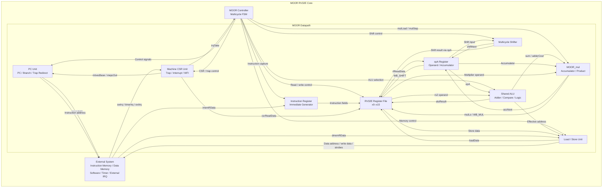
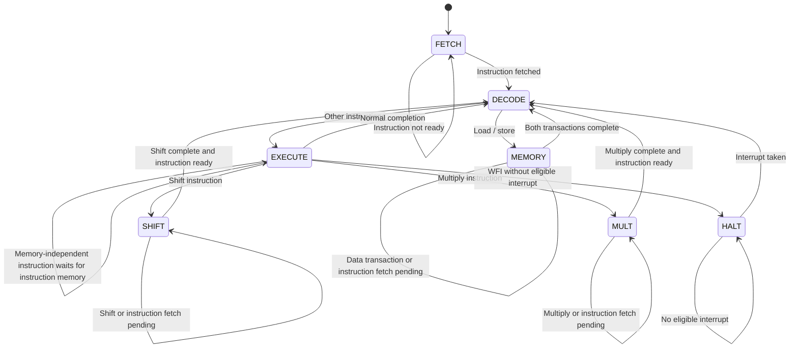

# MOOR — Minimal Overhead Optimized RISC-V

MOOR is an area-focused, multi-cycle RISC-V processor written in SystemVerilog. Its goal is simple: **build a practical RV32E core with machine-mode interrupt support while keeping hardware overhead as low as reasonably possible.**

> **Built in one night, with AI assistance.** The original `RV32E_Zicsr` implementation was developed in a single-night sprint with assistance from AI tools. MOOR has since evolved with additional features and optimizations, including optional `Zmmul` support.

## Design Goals

- Minimize area by sharing datapath hardware and avoiding unnecessary state.
- Use a multi-cycle controller rather than a fully pipelined architecture.
- Support machine-mode control, traps, and interrupt handling.
- Reuse the shared ALU adder for multiplication and address generation.
- Keep the RTL modular and configurable for implementation experiments.
- Provide separate instruction and data memory interfaces.

## Architecture



MOOR uses a shared ALU and a multi-cycle controller to reuse datapath hardware across instruction classes. Its multiplier is also multi-cycle: `MOOR_mul` uses the shared adder (`sum` and `adderCout`) and the `opA` register as an accumulator. This avoids requiring a separate full-width adder dedicated to the multiplier.

The register file supports configurable latch-based or flip-flop-based storage, while the shifter supports configurable multi-cycle operation.

## FSM



The controller has seven states: `FETCH`, `DECODE`, `EXECUTE`, `SHIFT`, `MULT`, `MEMORY`, and `HALT`. The `MULT` state sequences multiplication through the shared adder, while `SHIFT` handles iterative shift operations. Memory operations wait for the data transaction and instruction-fetch conditions required by the controller.

## Instruction-Set and CSR Reference

See the [ISA support reference](docs/isa_support.md) for instruction and CSR details.

MOOR supports the RV32E base integer ISA, `Zicsr` CSR instructions, and the optional `Zmmul` multiplication extension.

## Features

| Feature | Implementation |
| :--- | :--- |
| Architecture | 32-bit RV32E, 15 integer registers plus hardwired `x0` |
| Datapath | Multi-cycle, shared ALU |
| Integer operations | Add/subtract, comparisons, logical operations, shifts |
| Multiplication | `Zmmul`: `MUL`, `MULH`, `MULHSU`, `MULHU` |
| Control flow | Conditional branches, `JAL`, `JALR` |
| Memory operations | `LB`, `LH`, `LW`, `LBU`, `LHU`, `SB`, `SH`, `SW` |
| Upper-immediate operations | `LUI`, `AUIPC` |
| Machine control | CSR operations, `ECALL`, `MRET` |
| Interrupt inputs | Software, timer, and external interrupt signals |
| Idle instruction | `WFI` with a `HALT` state and interrupt-based wakeup |
| Register file | Configurable latch-based or flip-flop-based storage |
| Shifter | Configurable multi-cycle chunked or serial mode |
| Memory interface | Separate, single-beat AXI-style instruction and data interfaces |

## Interrupts and WFI

The core exposes three interrupt inputs:

| Input | Intended use | CSR enable bit |
| :--- | :--- | :--- |
| `swIrq` | Machine software interrupt | `mie.MSIE` |
| `timerIrq` | Machine timer interrupt | `mie.MTIE` |
| `extIrq` | Machine external interrupt | `mie.MEIE` |

The interrupt-take condition requires global `mstatus.MIE` and the corresponding per-source `mie` enable. The CSR block implements `mstatus`, `mie`, `mtvec`, `mepc`, `mip`, and parameterized `mhartid` reads.

`WFI` advances past the instruction and enters `HALT` when no eligible interrupt is being taken. While halted, the core waits for `irqTake`. When an eligible interrupt arrives, the controller enters the interrupt path and redirects execution to the trap vector. The saved return PC and interrupt-state behavior are handled by the CSR logic.

## Zmmul Extension

MOOR supports the RISC-V `Zmmul` extension through the configurable `ZMMUL` parameter.

| Parameter | Default | Purpose |
| :--- | :--- | :--- |
| `ZMMUL` | `1'b1` | Enables (`1`) or disables (`0`) multiplication support |

The parameter is propagated through `MOOR_core`, `MOOR_controller`, and `MOOR_datapath`.

The multiplier uses a multi-cycle algorithm with the shared adder. The controller initiates the operation with `mulLoad`, advances it with `mulStep`, and waits for `mulReady`. The multiplier uses `mulCorrA` and `mulCorrB` to select the appropriate operand and subtraction corrections during its iterative calculation.

The `opA` register serves as the accumulator, and the final result is selected through the write-back multiplexer. This architecture prioritizes hardware reuse over single-cycle multiplication latency.

`Zmmul` provides multiplication instructions without requiring the division instructions included in the full `M` extension.

## Parameters

| Parameter | Default | Purpose |
| :--- | :--- | :--- |
| `RESET_PC` | `32'h0000_0000` | Reset instruction address |
| `MTVEC_RESET` | `30'd0` | Reset value for the stored trap-vector base |
| `PC_BITS` | `12` | Instruction-address width at the core boundary |
| `USE_LATCH` | `1'b1` | Select latch-based (`1`) or FF-based (`0`) register-file storage |
| `SERIAL_SHIFTER` | `1'b0` | Select serial (`1`) or chunked multi-cycle (`0`) shifting |
| `ZMMUL` | `1'b1` | Enable or disable multiplication support |
| `HART_ID` | `32'd0` | Value returned by the `mhartid` CSR read |

With the default `PC_BITS = 12`, the instruction address exposed at the core boundary is 12 bits and is zero-extended to 32 bits. Increase this parameter if the target instruction memory requires a wider address range.

## Memory Interface

MOOR has separate instruction and data interfaces through `MOOR_axi_if`, using single-beat AXI-style channels.

- Instruction fetch uses `ARADDR`/`ARVALID` and consumes `RDATA`/`RVALID`; `RREADY` is held high.
- Data loads use the read channel; stores use the write-address, write-data, and write-response channels.
- The top-level adapter translates the core's request/ready handshake into these channels.
- The current integration configuration assumes prompt memory responses and is intended for a simple single-beat memory model.

The load/store unit supports naturally aligned byte, halfword, and word accesses. It generates byte strobes for stores and sign- or zero-extends load results.

## Synthesis and Timing Results

MOOR was synthesized with **Yosys and the Nangate45 standard-cell library** and evaluated with **OpenSTA**.

### Top-Level Results

| Flow | Reported cell area |
| :--- | ---: |
| Modular / hierarchical synthesis | 5,038.040 |
| Flattened synthesis | 4,654.468 |

Reported area is the sum of Nangate45 library cell-area values, not a floorplan or die-area estimate. The mapped cell counts for these new runs were not provided.

### Timing

| Flow | Minimum clock period | Maximum frequency |
| :--- | ---: | ---: |
| Flattened synthesis | 4.57 ns | 218.68 MHz |
| Modular / hierarchical synthesis | 3.48 ns | 287.28 MHz |

The reported frequency is calculated from the minimum clock period. The results differ between flows and should be interpreted in the context of each flow's constraints, synthesis settings, and timing model.

### Sequential Area

| Flow | Sequential cell area | Percentage of total area |
| :--- | ---: | ---: |
| Flattened synthesis | 905.198 | 19.45% |
| Modular / hierarchical synthesis | 883.918 | 17.54% |

### Largest Local Module Areas

The following figure shows local module areas from the modular synthesis report. These exclude child submodules and therefore do not sum to the flattened top-level area.

<p align="center">
  
</p>

The register file is a major area contributor. The latch-based register file includes 480 `DLH_X1` cells for its 15 × 32-bit stored registers, along with write-data sampling and read/write-selection logic.

For meaningful comparisons, use the same library, tool versions, timing constraints, optimization options, and parameter overrides. The reported tools include Yosys 0.65+57 and OpenSTA 3.1.0.

The RTL defaults are `PC_BITS=12`, `USE_LATCH=1`, `SERIAL_SHIFTER=0`, and `ZMMUL=1`.

## CoreMark Benchmark

MOOR was benchmarked using **CoreMark 1.0** on the RV32E core at **100 MHz**. Both configurations passed CoreMark's correctness validation.

### Results

| Metric | Without `Zmmul` | With `Zmmul` |
| :--- | ---: | ---: |
| Core clock | 100 MHz | 100 MHz |
| CoreMark size | 666 | 666 |
| Iterations | 500 | 1,000 |
| Execution time | 10.154 s | 11.117073 s |
| Iterations per second | 49.24 | 89.951731 |
| CoreMark/MHz | 0.4924 | 0.8995 |
| Compiler | GCC 16.1.0 | GCC 16.1.0 |
| Optimization | `-Ofast -flto` | `-Ofast -flto` |
| ISA | `rv32e_zicsr` | `rv32e_zicsr_zmmul` |
| ABI | `ilp32e` | `ilp32e` |
| Validation | Passed | Passed |

### Configuration Without Zmmul

Compiler options:

```text
-march=rv32e_zicsr -mabi=ilp32e -Ofast
-ffreestanding -fno-common -Wall -flto
-DPERFORMANCE_RUN=1
```

Reported result:

```text
CoreMark Size    : 666
Total time (secs): 10.154
Iterations       : 500
Iterations/Sec   : 49.24
CoreMark/MHz     : 0.4924
Correct operation validated.
```

### Configuration With Zmmul

Compiler options:

```text
-march=rv32e_zicsr_zmmul -mabi=ilp32e -Ofast
-ffreestanding -fno-common -Wall -flto
-DPERFORMANCE_RUN=1
```

The benchmark was linked using `link.ld`, `-nostdlib`, `-nostartfiles`, and `-lgcc`.

Reported result:

```text
CoreMark Size    : 666
Total ticks      : 1111707343
Total time (secs): 11.117073
Iterations/Sec   : 89.951731
Iterations       : 1000
Correct operation validated.
```

The `Zmmul`-enabled run reports approximately **0.8995 CoreMark/MHz**, compared with **0.4924 CoreMark/MHz** for the earlier configuration.

These results are not a fully controlled comparison because the iteration counts differ. The compiler ISA configuration also changed, allowing the compiler to generate multiplication instructions. The measurements demonstrate the performance of each reported configuration but do not isolate the multiplier's contribution. A controlled comparison should use identical benchmark settings and iteration counts, changing only the `ZMMUL` parameter and corresponding ISA flags.

## AI-Assisted Development

MOOR was built in a one-night development sprint with assistance from **ChatGPT (GPT), Claude, and DeepSeek**. The project explores how AI tools can accelerate RTL design, implementation, and debugging under a tight time constraint.

AI was used as a development aid alongside RTL iteration, synthesis, benchmarking, and static timing analysis.

## License

MOOR is licensed under the **CERN Open Hardware Licence Version 2 – Strongly Reciprocal (CERN-OHL-S-2.0)**.

You are free to use, modify, and manufacture hardware based on this project, provided you comply with the terms of CERN-OHL-S v2.

See the [LICENSE](LICENSE) file for details.
