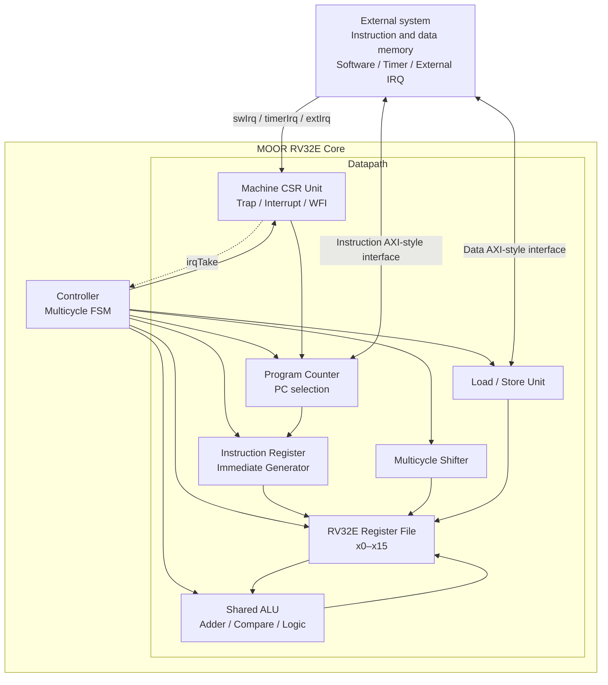
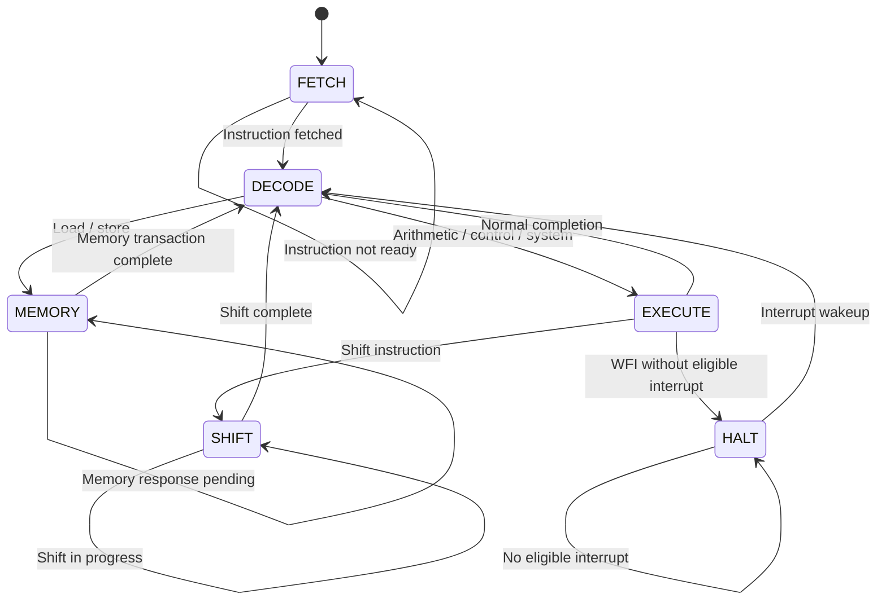
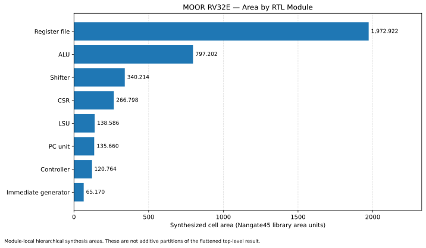

# MOOR — Minimal RV32E RISC-V Core

MOOR is an area-focused, multi-cycle RISC-V processor written in SystemVerilog. Its goal is simple: **build a practical RV32E core with machine-mode interrupts while keeping the hardware as small as reasonably possible.**

> **Built in one night, with AI assistance.** MOOR was developed in a single-night sprint with help from ChatGPT (GPT), Claude, and DeepSeek. AI accelerated architectural exploration, RTL implementation, and debugging, while synthesis and static timing analysis helped evaluate the resulting hardware.

## Design goals

- Minimize area by sharing datapath hardware and avoiding unnecessary state.
- Use a multi-cycle controller rather than a fully pipelined architecture.
- Support machine-mode control, traps, and interrupt handling.
- Keep the RTL modular and configurable for implementation experiments.
- Provide separate instruction and data memory interfaces.

## Architecture

MOOR uses a shared ALU and a multi-cycle controller to reuse datapath hardware across instruction classes. The register file can use latch-based or flip-flop-based storage, and the shifter can use chunked or serial operation.

## FSM

## Instruction-set and CSR reference

See the [ISA support reference](docs/isa_support.md) for the instruction and CSR details.

## Features

| Feature | Implementation |
| --- | --- |
| Architecture | 32-bit RV32E core with 15 integer registers plus hardwired `x0` |
| Datapath | Multi-cycle, shared ALU |
| Integer operations | Add/subtract, comparisons, logical operations, shifts |
| Control flow | Conditional branches, `JAL`, `JALR` |
| Memory operations | `LB`, `LH`, `LW`, `LBU`, `LHU`, `SB`, `SH`, `SW` |
| Upper-immediate operations | `LUI`, `AUIPC` |
| Machine control | CSR operations, `ECALL`, `MRET` |
| Interrupt inputs | Software, timer, and external interrupt signals |
| Idle instruction | `WFI` with a `HALT` state and interrupt-based wakeup |
| Register file | Configurable latch-based or flip-flop-based storage |
| Shifter | Configurable multi-cycle chunked or serial mode |
| Memory interface | Separate, single-beat AXI-style instruction and data interfaces |

## Interrupts and WFI

The core exposes three interrupt inputs:

| Input | Intended use | CSR enable bit |
| --- | --- | --- |
| `swIrq` | Machine software interrupt | `mie.MSIE` |
| `timerIrq` | Machine timer interrupt | `mie.MTIE` |
| `extIrq` | Machine external interrupt | `mie.MEIE` |

The interrupt-take condition requires global `mstatus.MIE` and the corresponding per-source `mie` enable. The CSR block implements `mstatus`, `mie`, `mtvec`, `mepc`, `mip`, and parameterized `mhartid` reads.

`WFI` advances past the instruction and enters `HALT` when no eligible interrupt is being taken. While halted, the core waits for `irqTake`; when an eligible interrupt arrives, the controller enters the interrupt path and redirects execution to the trap vector. The saved return PC and interrupt-state behavior are handled by the CSR logic.

## Parameters

| Parameter | Default | Purpose |
| --- | --- | --- |
| `RESET_PC` | `32'h0000_0000` | Reset instruction address |
| `MTVEC_RESET` | `30'd0` | Reset value for the stored trap-vector base |
| `PC_BITS` | `12` | Instruction-address width at the core boundary |
| `USE_LATCH` | `1'b1` | Select latch-based (`1`) or FF-based (`0`) register-file storage |
| `SERIAL_SHIFTER` | `1'b0` | Select serial (`1`) or chunked multi-cycle (`0`) shifting |
| `HART_ID` | `32'd0` | Value returned by the `mhartid` CSR read |

With the default `PC_BITS = 12`, the instruction address exposed at the core boundary is 12 bits and is zero-extended to 32 bits. Increase this parameter if the target instruction memory requires a wider address range.

## Memory interface

MOOR has separate instruction and data interfaces through `MOOR_axi_if`, using single-beat AXI-style channels:

- Instruction fetch uses `ARADDR`/`ARVALID` and consumes `RDATA`/`RVALID`; `RREADY` is held high.
- Data loads use the read channel; stores use the write-address, write-data, and write-response channels.
- The top-level adapter translates the core's request/ready handshake into these channels.
- The current integration configuration assumes prompt memory responses and is intended for a simple single-beat memory model.

The load/store unit supports naturally aligned byte, halfword, and word accesses. It generates byte strobes for stores and sign- or zero-extends load results.

## Synthesis and timing results

MOOR was synthesized with **Yosys and the Nangate45 standard-cell library** and evaluated with **OpenSTA**. The following values are from the supplied synthesis and timing run.

### Top-level results

| Flow | Mapped cells | Reported cell area |
| --- | ---: | ---: |
| Modular / hierarchical synthesis | 2,772 | 4,436.614 |
| Flattened synthesis | 2,457 | 4,126.192 |

In this run, flattening reduced the mapped cell count by 315 cells (about **11.4%**) and reported area by 310.422 units (about **7.0%**). Reported area is the sum of Nangate45 library cell-area values, not a floorplan or die-area estimate.

### Timing

| Metric | Result |
| --- | ---: |
| Minimum clock period reported by OpenSTA | 3.71 ns |
| Corresponding maximum frequency | 269.61 MHz |

The frequency is calculated from the reported minimum period and reflects the timing constraints and model used for this run.

### Largest local module areas

The following values come from the modular report. They are local module areas excluding child submodules, so they do not sum to the flattened top-level area.

  

The register file is the largest module in the modular report, followed by the shared ALU and shifter. The latch-based register file includes 480 `DLH_X1` cells for its 15 × 32-bit stored registers, along with write-data sampling and read/write-selection logic.

For meaningful comparisons, use the same library, tool versions, timing constraints, optimization options, and parameter overrides. The reported run used Yosys 0.65+57 and OpenSTA 3.1.0; the RTL defaults include `PC_BITS=12`, `USE_LATCH=1`, and `SERIAL_SHIFTER=0`.

## AI-assisted development

MOOR was built in a one-night development sprint with assistance from **ChatGPT (GPT), Claude, and DeepSeek**. The project explores how AI tools can accelerate RTL design, implementation, and debugging under a tight time constraint. AI was used as a development aid alongside RTL iteration, synthesis, and static timing analysis.

## License

MOOR is licensed under the **CERN Open Hardware Licence Version 2 – Strongly Reciprocal (CERN-OHL-S-2.0)**.

You are free to use, modify, and manufacture hardware based on this project, provided you comply with the terms of CERN-OHL-S v2.

See the [LICENSE](LICENSE) file for details.
